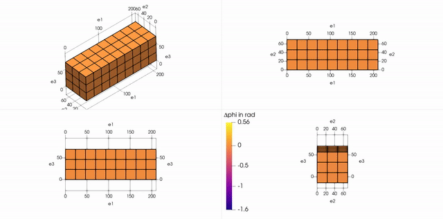

# sgiga

**S**econd-**G**radient **I**so**G**eometric **A**nalysis — a small nonlinear FEM/IGA
package for continuum mechanics, focused on:

- **Hyperelasticity** (Ogden-type first-gradient continua, compressible and incompressible)
- **Second-gradient continuum theory**, including beam-network material models used to
  represent pantographic sheets and orthotropic blocks (mechanical metamaterials)
- **Isogeometric analysis**: B-spline/Bezier discretization in 1D/2D/3D, alongside a
  classical Lagrange discretization for comparison
- A small set of nonlinear solvers (Newton, Euler backward, generalized-α) built around
  a sparse-assembly `Model`/`Coo` container

This is a trimmed, cleaned-up personal fork of a larger research codebase (see
[Acknowledgments](#acknowledgments)), kept to the parts needed to run the examples
below (12 scripts: 10 working, 2 kept as documented known-limitation references).

## Installation

Requires Python ≥3.10.

```bash
git clone https://github.com/simaxinran/sgiga
cd sgiga
python3 -m venv .venv
source .venv/bin/activate
pip install -e .
```

## Examples

All examples live in `examples/` and are run directly with Python from the repo root;
each writes VTK/ParaView output to a gitignored `results/` folder.

```bash
python examples/continuum_cube.py
```

**First-gradient continuum, B-spline (IGA) discretization**

| Script | What it demonstrates |
| --- | --- |
| `continuum_cube.py` | Hyperelastic (Ogden) cube under prescribed face displacement, static Newton solve. |
| `continuum_cylinder.py` | Hyperelastic cylinder twisted about its axis. |
| `continuum_rectangle.py` | Hyperelastic 2D rectangle under prescribed edge displacement. |

**First-gradient continuum, classical Lagrange discretization** — same problems as
above, solved with Lagrange elements instead of B-splines for comparison:

| Script | What it demonstrates |
| --- | --- |
| `continuum_lagrange_cube.py` | Incompressible hyperelastic cube under traction, mixed displacement/pressure formulation. |
| `continuum_lagrange_cylinder.py` | Hyperelastic cylinder twisted about its axis. **Known issue**: converges to a configuration with an inverted element near the axis, which then fails during VTK post-processing — kept as a documented limitation (see module docstring), not silently dropped. |
| `continuum_lagrange_rectangle.py` | Hyperelastic 2D rectangle under prescribed edge displacement. |

**Second-gradient continuum** — the microstructure-aware theory behind the
pantographic examples below:

| Script | What it demonstrates |
| --- | --- |
| `continuum_second_gradient_cube.py` | Second-gradient continuum (`Pantobox_beam_network` material) cube under tension. |
| `continuum_second_gradient_embedded_rectangle.py` | Pantographic sheet embedded in 3D space, using `Pantosheet_beam_network`. **Known issue**: originally NaN'd from the first Newton iteration (root cause found and fixed — a mesh-basis mismatch); the Newton solve still fails to converge afterward for reasons not yet fully diagnosed. The original authors flagged this material model `# TODO: untested!`; kept in for future debugging (see module docstring). |

**Pantographic ortho-block** — see [Stilz et al. (2023)](https://doi.org/10.1016/j.ijsolstr.2023.112358):

| Script | What it demonstrates |
| --- | --- |
| `pantographic_ortho_block_tension.py` | 3D pantographic/orthotropic block clamped and pulled in tension, strong (Dirichlet) boundary conditions, larger IGA mesh. |
| `pantographic_ortho_block_torsion.py` | Same block twisted up to 90° about its axis. |
| `pantographic_ortho_block_tension_weak.py` | Same tension loading as `_tension.py`, but every boundary condition is applied weakly (Lagrange multipliers) instead of via strong Dirichlet elimination — a worked example of the weak-constraint API, not a different physical result. |
| `pantographic_ortho_block_gradient_bc.py` | Both end faces clamped at *zero* displacement (they never move); the block deforms anyway, driven purely by a prescribed out-of-plane displacement-gradient target on the top face — impossible to express, or to have any effect, in first-gradient theory. See below. |

Output `.vtu`/`.pvd` files can be opened in [ParaView](https://www.paraview.org/) to
visualize the deformed configuration.

### Gradient boundary conditions

Second-gradient continua support constraining the displacement *gradient* on a
boundary, not just the displacement itself — and, unlike the displacement, the
gradient's *target value* can be driven away from zero, turning it into a genuine
loading mechanism in its own right. Both are implemented as Lagrange-multiplier
constraints in
`sgiga/model/bilateral_constraints/implicit/displacement_gradient_constraint.py`:

- `Displacement_constraint` — standard Dirichlet condition on the displacement field,
  optionally to a prescribed (time-varying) target via `disp=`.
- `Gradient_constraint` — constrains a component of the displacement gradient
  (∂u/∂X) on a boundary surface, optionally to a prescribed (time-varying) target via
  `disp=` (0 by default, i.e. flat/unchanged).

`examples/pantographic_ortho_block_gradient_bc.py` uses both end faces' displacement
fully clamped at zero (`Displacement_constraint`, default `disp=0` — the faces never
move) plus `Gradient_constraint` on the out-of-plane component d(u_z)/dZ, with the
bottom face's target left at 0 (flat, anchor) and the top face's target driven to a
nonzero, growing value over the load history. Because every displacement is fixed at
zero, a first-gradient continuum under this same boundary condition has nothing to
respond to (the trivial zero solution); here the block visibly deforms anyway, driven
entirely through the second-gradient boundary term.

## Visuals

Renders and clips made in ParaView from the examples above:



*Pantographic ortho-block under a gradient boundary condition (see
[Gradient boundary conditions](#gradient-boundary-conditions) above). Full-quality
clip: [panto_ortho_block_gradient_boundary.mp4](docs/videos/panto_ortho_block_gradient_boundary.mp4).*

<!--  -->

## Project structure

```
sgiga/
  discretization/   B-spline, Lagrange, and mesh (1D/2D/3D) discretization
  math/              small linear-algebra and numerical-derivative utilities
  model/             continuum/material models, forces, constraints, rigid bodies
  solver/            Newton, Euler backward, generalized-alpha solvers
  utility/           sparse-matrix assembly container, VTK post-processing
examples/            the 12 example scripts described above
docs/images/         screenshots/renders embedded above
docs/videos/         short clips embedded above (GitHub inlines short .mp4/.gif well)
doc/dictionary.md     glossary of the variable-naming conventions used throughout
```

## References

- M. Stilz, S. R. Eugster, J. Harsch, F. Gutmann, G. Ganzenmüller, S. Hiermaier,
  "A second-gradient elasticity model and isogeometric analysis for the pantographic
  ortho-block," *International Journal of Solids and Structures*, vol. 280, 112358,
  2023. [doi:10.1016/j.ijsolstr.2023.112358](https://doi.org/10.1016/j.ijsolstr.2023.112358)
  — theory and formulation behind `examples/pantographic_ortho_block_*.py`.

## Acknowledgments

This package started as `cardillo`, a research FEM/IGA code co-developed at the
Institute of Nonlinear Mechanics, University of Stuttgart, with Jonas Harsch, Giuseppe
Capobianco, and Simon Eugster. This repository is my own, heavily trimmed personal fork
— curated down to the second-gradient/IGA continuum mechanics I worked on, cleaned up,
and modernized for a current Python/SciPy/meshio toolchain. It is not the original
project and does not track its history.

## License

MIT — see [LICENSE](LICENSE).
